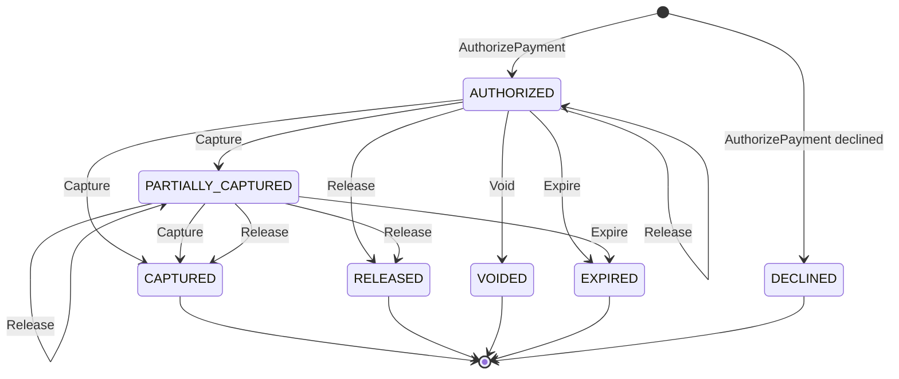
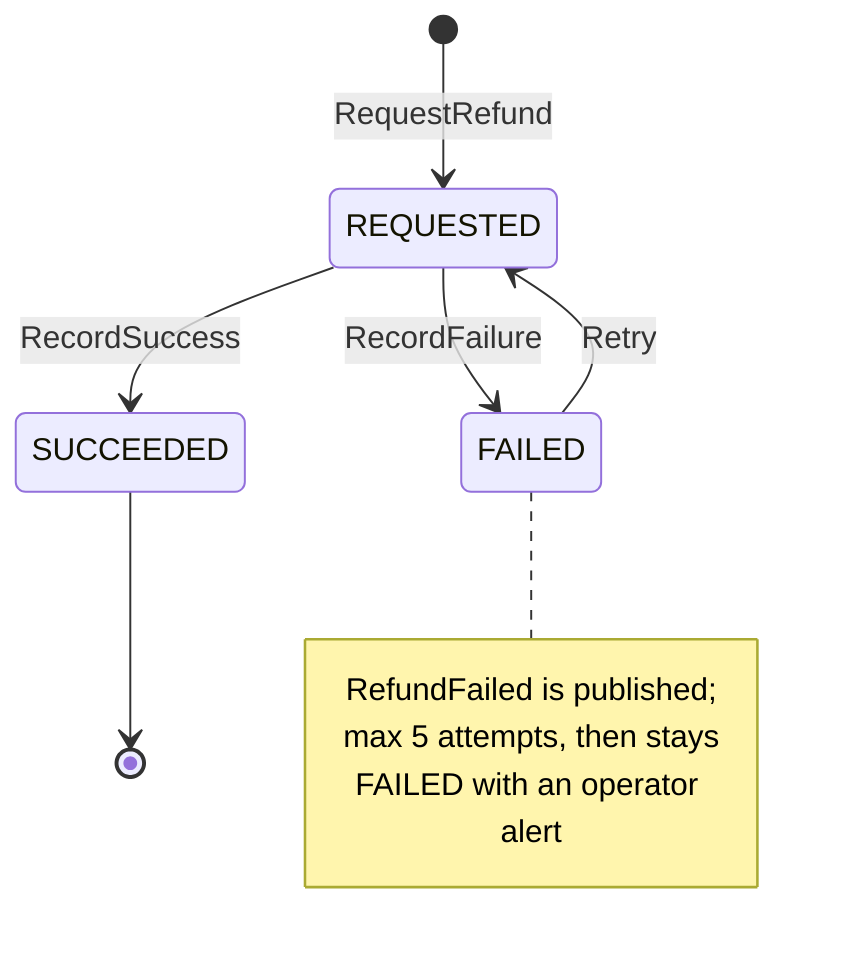

# Aggregate design canvas

Following the ddd-crew
[Aggregate Design Canvas v1.1](https://github.com/ddd-crew/aggregate-design-canvas).
Two aggregate roots, **PaymentAuthorization** (`internal/domain/paymentauthorization`)
and **Refund** (`internal/domain/refund`), and one read model, the parked facts
(`internal/application/parked`, table `parked_facts`).

## PaymentAuthorization

### 1. Name and 2. Description

`paymentauthorization.PaymentAuthorization`, identified by `authorizationId`
(`pay-<12 hex>` as minted by the id generator). One checkout session's authorization:
`checkoutSessionId`, `orderId` (bound later), PSP token, currency, `totalMinor`,
`allocations`, the provider hold id and `expiresAt`, a re-authorization counter and an
optimistic `version`. The state is derived from the allocations. The aggregate holds no
card data.

| Value object | Fields | Note |
| --- | --- | --- |
| `Allocation` | `GroupNo`, `AmountMinor`, `State` (`PENDING`, `CAPTURED`, `RELEASED`), `CapturedMinor`, tracking numbers, provider capture id | the unit of capture and release; tracking numbers are set at capture |
| `Draft` / `AllocationInput` | session, token, currency, total, allocations | validated by `paymentauthorization.Check` before the provider is called |
| `Outcome` | provider hold id and expiry, or a decline reason | what the provider answered |

### 3. State transitions

Source: `internal/domain/paymentauthorization/paymentauthorization.go` (states and
`State()` derivation), `commands.go` (`Capture`, `Release`, `Void`, `Expire`,
`Reauthorize`, `BindOrder`), `create.go` (`New`), and the `CHECK` on
`payment_authorizations.state` in `0001_customer_payments_schema.up.sql`.

The entry arrows are the creating command: an approved authorize creates the record
`AUTHORIZED`, a declined one creates it `DECLINED`. The state is derived:
`PARTIALLY_CAPTURED` while some allocations are captured and some pending, `CAPTURED`
when all are captured or released with at least one captured, `RELEASED` when all are
released. `Reauthorize` keeps the state and replaces `expiresAt` and the hold id.
`BindOrder` sets the order and changes no state. A provider decline on re-authorization
expires the authorization and raises `PaymentDeclined` with reason `REAUTH_DECLINED`.

### 4. Enforced invariants

| Invariant | Error (REST slug) |
| --- | --- |
| Allocations sum to the total and name distinct groups | `ErrAllocationMismatch` (`allocation-mismatch`) |
| No negative amount | `ErrNegativeAmount` (`negative-amount`) |
| Captured per group never exceeds the allocation | `ErrOverCapture` (`over-capture`) |
| No capture after `expiresAt` | `ErrCaptureAfterExpiry` (`capture-after-expiry`) |
| A capture or release names an existing group | `ErrUnknownGroup` (`unknown-group`) |
| One order per authorization | `ErrOrderAlreadyBound` (`order-already-bound`) |
| Void only from `AUTHORIZED`; a captured group cannot be released | `ErrIllegalTransition` (`illegal-transition`) |
| One live authorization per session / per order | unique partial indexes; `ErrDuplicateAuthorization` (`duplicate-authorization`) on a race |
| Concurrent writers | version check; `concurrent-update` |

### 5. Corrective policies

| Policy | Rule | Effect |
| --- | --- | --- |
| Bind on `CheckoutCompleted` | bind the order, then apply the parked facts | `BindOrder` |
| Capture on shipment | `FulfillmentShipped`: capture the group, store tracking numbers | `PaymentCaptured` |
| Release on cancellation / unsourceable | release the group, shrink or void the hold | `PaymentReleased` (`CANCELLED`, `UNSOURCEABLE`) |
| `reauthorize-before-expiry` | 24 h before `expiresAt` renew the pending amount | `PaymentReauthorized`, or expire + `PaymentDeclined` (`REAUTH_DECLINED`) |
| `void-unbound-authorizations` | no order after 24 h: void | `PaymentReleased` (`VOIDED`) |
| Idempotent consumption | inbox on the CloudEvents `id`; deterministic provider keys | a replay never moves money twice |

### 6. Handled commands and 7. Created events

| Command | Trigger | Transition | Event |
| --- | --- | --- | --- |
| `AuthorizePayment` | REST | `[*] → AUTHORIZED` or `DECLINED` | `PaymentAuthorized` or `PaymentDeclined` |
| `Capture` | Kafka `FulfillmentShipped` | to `PARTIALLY_CAPTURED` or `CAPTURED` | `PaymentCaptured` |
| `Release` | Kafka cancelled / unsourceable | allocation `RELEASED`, state follows | `PaymentReleased` |
| `Void` | REST, policy | `AUTHORIZED → VOIDED` | `PaymentReleased` (`VOIDED`) per allocation |
| `Expire` | decline of a re-authorization, or a lapsed hold | `→ EXPIRED` | `PaymentAuthorizationExpired` |
| `Reauthorize` | policy | `AUTHORIZED → AUTHORIZED` | `PaymentReauthorized` |
| `BindOrder` | Kafka `CheckoutCompleted` | none | none |

Full types: `com.retailnetwork.storefront.customer-payments.paymentauthorization.<Event>`.
All are analytics-only; they leave through the transactional outbox in the same
transaction as the save.

### 8. Throughput and 9. Size

One authorize per completed or abandoned session, then one capture or release per
group over the following days. Contention on one `authorizationId` comes from facts for
several groups of the same order landing together; the `version` column absorbs them.
One root row plus a handful of allocation rows (one per shipment group).

## Refund

### 1. Name and 2. Description

`refund.Refund`, identified by `refundId` (`ref-<12 hex>`): money returned for one order
or one group: `authorizationId`, `orderId`, `groupNo` (0 = order level), currency,
`amountMinor`, `reason`, `state`, `attempts`, `failureCode`, provider refund id.

### 3. State transitions

Source: `internal/domain/refund/refund.go` (`StateRequested`, `StateSucceeded`,
`StateFailed`, `MaxAttempts`, `Exhausted`), `commands.go` (`RecordSuccess`,
`RecordFailure`, `Retry`), `internal/application/usecases/refund.go`.

### 4. Invariant, 5. Policies, 6. Commands, 7. Events

| Item | Content |
| --- | --- |
| Invariant | refunds of the order (and of the group when `groupNo > 0`) never exceed what was captured; `REQUESTED` and `SUCCEEDED` count, `FAILED` never does (`ErrOverRefund`, `over-refund`); `amountMinor >= 1`; valid reason |
| Policies | refund on `PackageLost` (reason `LOST`) and on `PackageReturned` (reason `RETURNED_TO_SENDER`): the captured amount of the group that carried the tracking number, less refunds already made or requested; `process-requested-refunds` settles refunds a provider outage left `REQUESTED` |
| Commands | `RequestRefund` (REST, policies), `RecordSuccess` / `RecordFailure` (the provider's answer), `RetryRefund` (REST) |
| Events | `RefundIssued` (`com.retailnetwork.storefront.customer-payments.refund.RefundIssued`), `RefundFailed` (with `code`, `attempts`, `final`) |

Throughput is low: a refund follows a lost or returned package or an ops request. One
row per refund.

## Read model: parked facts

| Read model | Source events | Serves | Why not an aggregate |
| --- | --- | --- | --- |
| `parked_facts` (`parked.Fact`) | shipped, cancelled, unsourceable, lost, returned, for orders not yet bound (or lost / returned whose tracking number no capture carries yet) | `Consumer.CheckoutCompleted` and `ApplyFact`, which re-apply them after the bind or the capture | it protects no invariant; the commands it causes are validated by the aggregates. Escalated to a DLQ topic after 24 h, purged after 30 days; gauge `customer_payments_parked_facts`. |
