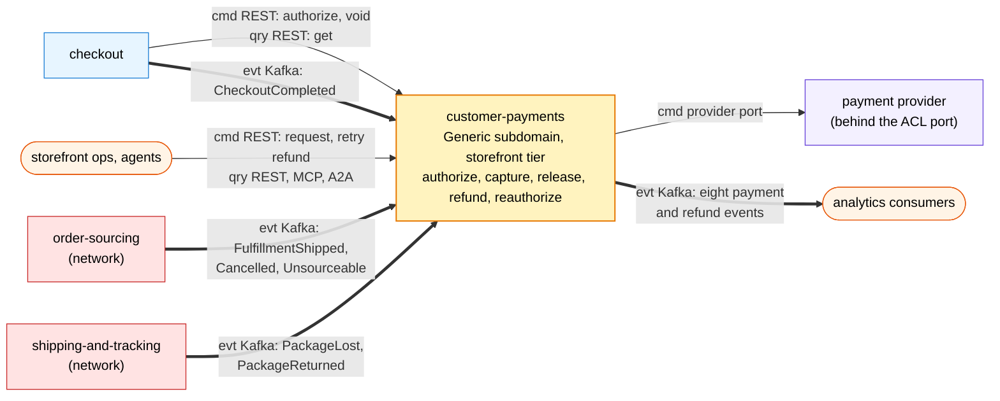

# Bounded context canvas

Following the ddd-crew
[Bounded Context Canvas v5](https://github.com/ddd-crew/bounded-context-canvas).
Every message row was checked against `apis/openapi.yaml`, `apis/asyncapi.yaml`, the
router (`internal/adapters/inbound/http/server.go`), the consumers
(`internal/adapters/inbound/kafka/handlers.go`) and the encoder
(`internal/adapters/outbound/kafka`).

## At a glance

Source: `cmd/api/main.go`, `cmd/mcp/main.go`, `cmd/a2a/main.go`,
`internal/adapters/inbound/http/server.go`, `internal/adapters/inbound/kafka/handlers.go`,
`internal/adapters/outbound/paymentprovider/client.go`.

## Name

**Customer Payments** (`customer-payments`, CloudEvents tier `storefront`).

## Purpose

Move money with the shipment facts. The context authorizes the quote total once per
checkout session split into one allocation per shipment group; captures a group's
allocation when it ships and stores the tracking numbers; releases it when the group
is cancelled or unsourceable; voids an authorization before any capture; refunds the
captured amount of a group whose package is lost or returned, or on request;
re-authorizes uncaptured allocations 24 h before expiry; voids authorizations no
`CheckoutCompleted` bound within 24 h; and parks fulfilment facts for orders not yet
bound.

## Strategic classification

| Axis | Verdict |
| --- | --- |
| Domain | **Generic** ([Core domain chart](/docs/ddd/core-domain-chart)) |
| Business model | Revenue collection (buy a PSP) |
| Evolution | Commodity |

## Domain roles

| Role | Applies? | Evidence |
| --- | --- | --- |
| Execution (authorize, capture, void, refund) | **Yes, primary** | the two aggregates and the provider verbs; `ErrOverCapture`, `ErrOverRefund` guard the money moving |
| Enforcer (never two holds for one session) | **Yes** | one live authorization per session and per order (unique partial indexes), a repeat returns it |
| Analysis | No | the only read model, `parked_facts`, holds facts to apply, not a verdict others consume |
| Specification | No | prices come from `pricing` via `checkout`; this context never computes one |

## Inbound communication

| Collaborator | Message | Type | Channel | Relationship |
| --- | --- | --- | --- | --- |
| checkout | `AuthorizePayment` | command | REST `POST /payment-authorizations` | Customer/Supplier (we supply) |
| checkout | `VoidAuthorization` | command | REST `POST /payment-authorizations/{authorizationId}/voids` | Customer/Supplier |
| checkout, ops | `GetAuthorization`, `ListAuthorizations` | query | REST `GET /payment-authorizations...` | Customer/Supplier, UI |
| ops | `RequestRefund`, `RetryRefund` | command | REST `POST /refunds`, `POST /refunds/{refundId}:retry` | UI |
| ops | `GetRefund`, `ListRefunds` | query | REST `GET /refunds...` | UI |
| agents | four MCP tools, two A2A skills | query | `cmd/mcp`, `cmd/a2a` | UI |
| checkout | `CheckoutCompleted` | event | Kafka `retailnetwork.checkout.events`, `com.retailnetwork.storefront.checkout.checkoutsession.CheckoutCompleted` | Customer/Supplier (we consume) |
| order-sourcing | `FulfillmentShipped`, `FulfillmentCancelled`, `FulfillmentUnsourceable` | event | Kafka `retailnetwork.order-sourcing.events`, `com.retailnetwork.commerce.order-sourcing.assignment.<Event>` | Conformist |
| shipping-and-tracking | `PackageLost`, `PackageReturned` | event | Kafka `retailnetwork.shipping-and-tracking.events`, `com.retailnetwork.logistics.shipping-and-tracking.journey.<Event>` | Conformist |

`CaptureAllocation`, `ReleaseAllocation`, `ReauthorizePayment`, `ExpireAuthorization`,
`BindOrder` and `RecordRefundOutcome` have no route: they arrive through events,
policies and provider answers, never as REST writes.

## Outbound communication

| Collaborator | Message | Type | Channel |
| --- | --- | --- | --- |
| payment provider | authorize, capture, void, refund, reauthorize, reduce | command | provider port (ACL) over HTTP, `PAYMENT_PROVIDER_URL` |
| analytics | `PaymentAuthorized`, `PaymentCaptured`, `PaymentReleased`, `PaymentAuthorizationExpired`, `PaymentDeclined`, `PaymentReauthorized`, `RefundIssued`, `RefundFailed` | event | Kafka `retailnetwork.customer-payments.events`, type `com.retailnetwork.storefront.customer-payments.<entity>.<Event>` |
| operators | fulfilment facts left unbound for 24 h | event (plain JSON) | Kafka `retailnetwork.customer-payments.unbound-facts.dlq` |

Nobody in the storefront or the network consumes the payment events today; checkout
learns the outcome of an authorize from the synchronous reply.

## Ubiquitous language

Full glossary: [Ubiquitous language](/docs/ddd/ubiquitous-language). Top terms:
**Payment Authorization**, **Allocation**, **Capture**, **Release** (one allocation,
not **Void**), **Refund**, **Reauthorization**, **Payment Method Token**.

## Business decisions

1. One live authorization per checkout session; a repeated authorize returns it.
2. Allocations sum to the total and name distinct groups (`allocation-mismatch`); a
   capture or release names an existing group (`unknown-group`).
3. Capture is per allocation: never above the allocation (`over-capture`), never
   after `expiresAt` (`capture-after-expiry`).
4. Refunds of an order never exceed its captured total (`over-refund`).
5. Fulfilment facts for a not-yet-bound order are parked and applied on bind.
6. Provider idempotency keys are deterministic per (operation, authorization, group).
7. A declined authorize is a stored result; the checkout session stays open.

## Assumptions

- Checkout sends a stable `Idempotency-Key` per logical request and calls void only
  after a definitive rejection of the place-order step.
- The PSP token arrives in the authorize request; card data never does.
- The provider honours the idempotency key it is given.
- Every consumed event is applied once (inbox on the CloudEvents `id`).
- Money is `{amountMinor, currency}`, integer minor units.

## Verification metrics

| Metric | Target | Source |
| --- | --- | --- |
| Authorization outcomes by `outcome` and `reason` | tracked; separates declines from provider outages | OTel counter `payments.authorizations.decided` |
| Parked facts waiting for a bind | tracked | `customer_payments_parked_facts` gauge at `GET /metrics` |
| Captures without a matching `FulfillmentShipped` | 0 | `PaymentCaptured` joined to shipment facts (no instrument in code) |
| Shipped groups whose authorization expired uncaptured | 0 | `PaymentAuthorizationExpired` against shipped groups |
| Oldest unpublished outbox row | seconds | `outbox_events WHERE published_at IS NULL` (no instrument in code) |
| Refunds `REQUESTED` and unsettled | tracked | `refunds.state` |

## Open questions

- **Nothing consumes our events.** All eight are analytics-only; the first consumer
  would be a future `customer-notifications` context.
- **No alert rules.** `warehouse-infra` has a dashboard for this context but no alert
  group ([Observability](/docs/operations/observability#dashboards-and-alerts)).
- **Spec drift.** The OpenAPI document lacks `RELEASED`, two refund routes and the
  `200` replay of a live authorization is documented since the REST guideline cutover ([API overview](/docs/api-reference#spec-versus-code)).
