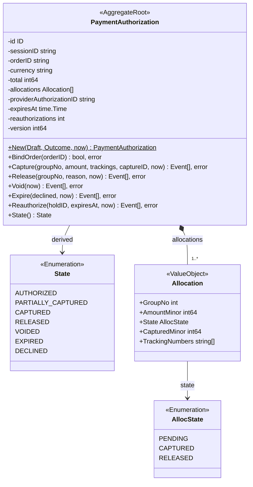
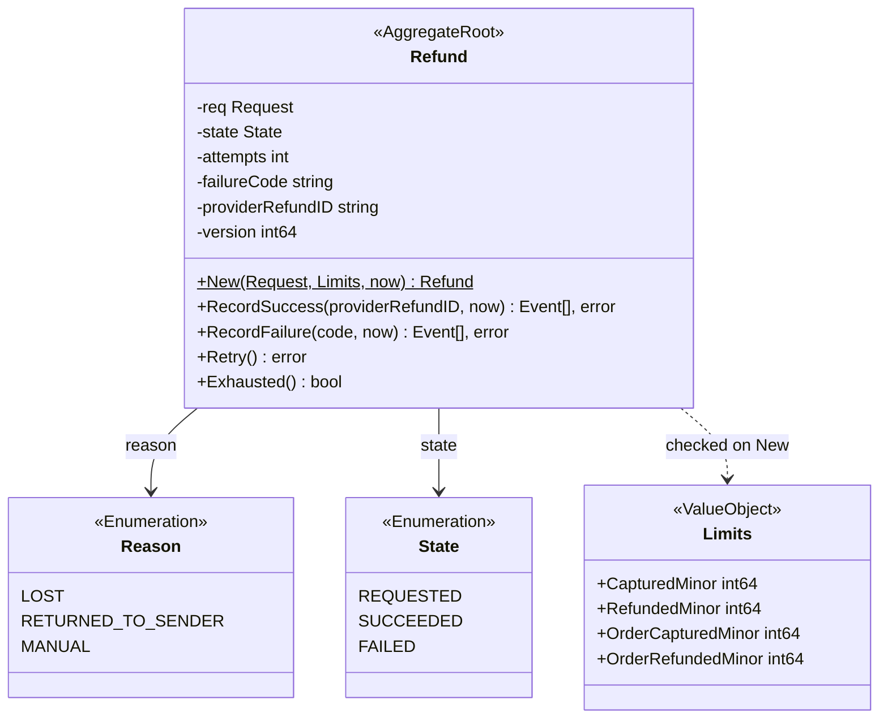
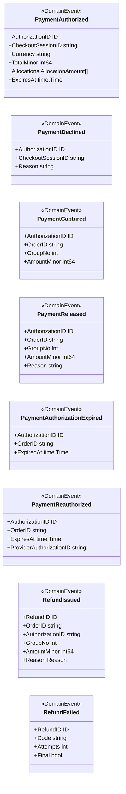
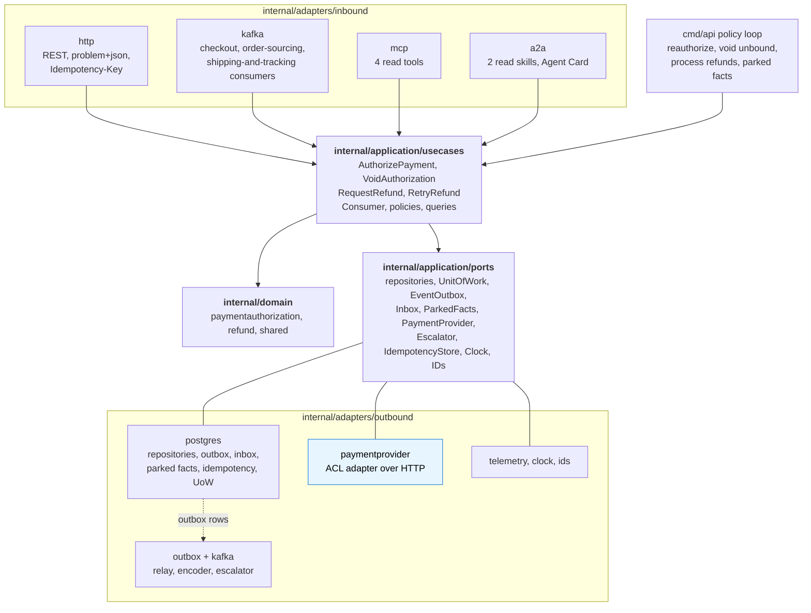

# Class diagram

UML of the `internal/domain/**` packages and the hexagonal ports and adapters as
built. Fields are unexported in Go and shown with `-`; methods with `+`. Exported
domain types: `paymentauthorization`: `ID`, `State`, `AllocState`, `Allocation`,
`AllocationInput`, `Draft`, `Outcome`, `PaymentAuthorization`, `Snapshot` and the
events; `refund`: `ID`, `State`, `Reason`, `Request`, `Limits`, `Refund`, `Snapshot` and
the events.

## 1. The PaymentAuthorization aggregate

Source: `internal/domain/paymentauthorization/paymentauthorization.go`, `create.go`,
`commands.go`, `restore.go`.

## 2. The Refund aggregate

Source: `internal/domain/refund/refund.go`, `commands.go`,
`internal/application/usecases/refund.go` (`limitsFor`).

## 3. Domain events

Source: `internal/domain/paymentauthorization/events.go`,
`internal/domain/refund/events.go`.

## 4. Hexagonal ports and adapters

Source: `cmd/api/main.go` (`buildAdapters`, `buildServer`), `internal/application/usecases/deps.go`
(`Deps`), `internal/application/ports/ports.go`, the package list under
`internal/adapters/`. The memory adapter and `repocontract` are test support.

**The Anti-Corruption Layer.** The `PaymentProvider` port speaks the domain's language
(a PSP token, an amount in minor units, a deterministic key) and returns domain
results (a hold with an expiry, a decline code). Everything the provider names
differently stays in `internal/adapters/outbound/paymentprovider`; the simulator is its
stand-in and a real provider replaces only this package. The only outbound client of the
service is this adapter. `cmd/mcp` and `cmd/a2a` wire only the repositories and the
read use cases.
