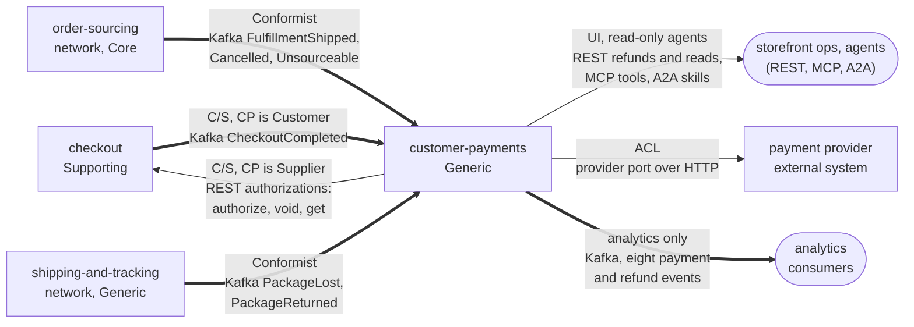

# Context map

Following ddd-crew [Context Mapping](https://github.com/ddd-crew/context-mapping).
This is Customer Payments' slice of the
[storefront context map](https://iqvo.github.io/warehouse-docs/storefront/strategic-design/context-map):
every relationship this context has, with the pattern and the channel.

Source: `cmd/api/main.go` (`consumerSpecs`: the three consumers),
`internal/adapters/inbound/http/server.go` (routes),
`internal/adapters/inbound/kafka/handlers.go` (consumed topics and types),
`internal/adapters/outbound/paymentprovider/client.go` (the ACL),
`internal/adapters/outbound/kafka/payloads.go` (`TopicEvents`), `apis/asyncapi.yaml`.

Arrows point from upstream to downstream, except the Kafka arrow from `checkout`,
whose label gives the true direction. Solid = synchronous (REST, provider port);
thick = Kafka.

## Relationships

| Neighbour | Direction | Pattern | Channel | Messages |
| --- | --- | --- | --- | --- |
| `checkout` (Supporting) | we are upstream | Customer/Supplier (checkout is the Customer) | REST `POST /payment-authorizations`, `POST /payment-authorizations/{authorizationId}/voids`, `GET /payment-authorizations/{authorizationId}` | authorize, void, get |
| `checkout` | checkout is upstream | Customer/Supplier (we are the Customer) | Kafka `retailnetwork.checkout.events` | `CheckoutCompleted` |
| storefront ops, agents | we are upstream | UI | REST `POST /refunds`, `GET /refunds...`, `GET /payment-authorizations...`; MCP `cmd/mcp`; A2A `cmd/a2a` | request, retry and read |
| `order-sourcing` (network, Core) | network is upstream | Conformist | Kafka `retailnetwork.order-sourcing.events` | `FulfillmentShipped`, `FulfillmentCancelled`, `FulfillmentUnsourceable` |
| `shipping-and-tracking` (network, Generic) | network is upstream | Conformist | Kafka `retailnetwork.shipping-and-tracking.events` | `PackageLost`, `PackageReturned` |
| payment provider (external) | we call it | Anti-Corruption Layer | `PAYMENT_PROVIDER_URL`, HTTP/JSON | authorize, capture, void, refund, reauthorize, reduce |
| analytics consumers | we are upstream | analytics stream | Kafka `retailnetwork.customer-payments.events` | the eight events of [Events](/docs/api-reference/events) |

## Notes on the patterns

- **One ACL, and it is outbound.** The domain sees a few provider verbs, a PSP token
  and deterministic idempotency keys; wire names, error codes and the shape of a hold
  reference are translated inside `internal/adapters/outbound/paymentprovider`. The
  same discipline keeps the card number out of the storefront.
- **Two Conformist edges from the network.** The shipment, cancellation, lost and
  returned facts are taken as published; the context never asks the network to
  change a payload.
- **Cross-topic order is the price of event-driven money.** The three inbound topics
  have no ordering between them, so a shipment fact can precede `CheckoutCompleted`.
  The answer is parking, not a synchronous call to any of the three.
- **The provider is the only synchronous call out.** Every other flow is a Kafka event
  or an inbound call.
- **A dead end for events.** Nothing consumes our events today ([Integration](/docs/ecosystem/integration)).
- **No Shared Kernel.** `orderId`, `groupNo` and `trackingNumber` are values copied
  from messages, never shared code.
- **Separate Ways** with `pricing`, `shopping-cart`, `product-content`,
  `product-discovery` and every other network context; in particular no call to
  `customer-ordering`. No `warehouse.*` topic is touched.
