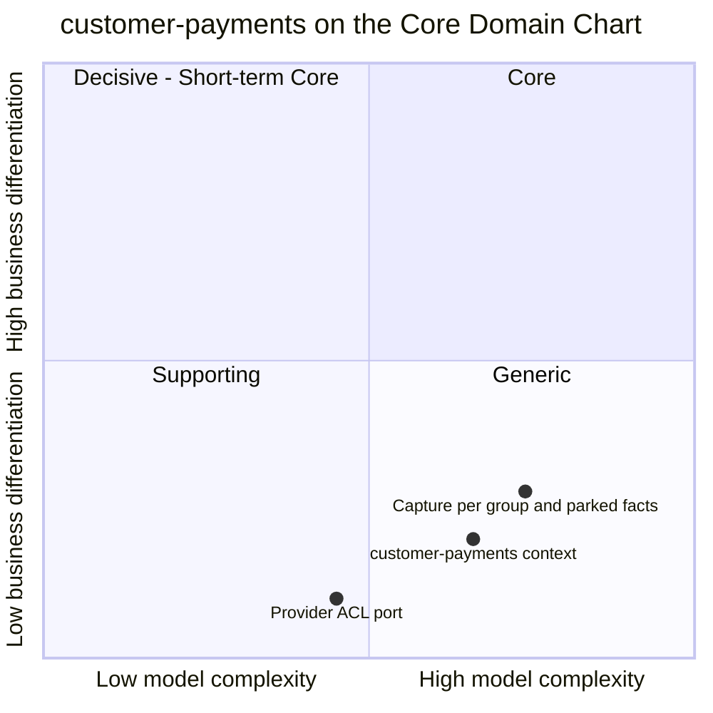

# Core domain chart

Following the ddd-crew
[Core Domain Charts](https://github.com/ddd-crew/core-domain-charts): business
differentiation (y) against model complexity (x).

Source: the placement is a judgement recorded in the storefront model
(`complexity 0.66`, `differentiation 0.2`, `evolution Commodity`, in
[warehouse-docs](https://iqvo.github.io/warehouse-docs/storefront/contexts/customer-payments/core-domain-chart));
the two slices are drawn from `internal/application/usecases/consume.go`,
`facts.go`, `internal/application/parked` (capture per group, parked facts) and
`internal/adapters/outbound/paymentprovider/client.go` (the ACL port).

## Classification: Generic

The context sits in quadrant 4 (Generic), far to the right. A shopper does not
choose this storefront because of how it authorizes a card; the right answer is to
buy that capability from a provider and keep the domain code thin. The code does
that: the provider is behind a port and swappable
([Subdomain classification](/docs/ddd/subdomain-classification)).

**Differentiation is low (0.2).** Collecting revenue is a necessity, not a
strength. The only part with a shape of its own is pairing the money lifecycle with
the network's shipment groups, which is a rule (capture what ships), not an edge.

**Complexity is high for a Generic context (0.66).** The reasons are all visible in
the code:

- **Foreign clocks.** Holds expire at the provider's clock (`expiresAt`): the policy
  `reauthorize-before-expiry` renews 24 h ahead and `ErrCaptureAfterExpiry` forbids
  a capture after expiry.
- **Cross-topic event order.** `FulfillmentShipped` can arrive before
  `CheckoutCompleted`. The context parks the fact (`parked_facts`) and applies it on
  bind, adding a read model, an escalation and a purge to a small domain.
- **Money invariants across two aggregates.** Captured per group never exceeds the
  allocation (`ErrOverCapture`); refunds never exceed what was captured
  (`ErrOverRefund`); allocations sum to the total (`ErrAllocationMismatch`).
- **A port that must be idempotent by construction.** Every provider call carries a
  deterministic key (`usecases.Key`).

The **provider ACL** slice is plotted lowest and leftmost: a handful of verbs and a
translation layer are the commodity part, the one place where buying beats building.

## Business model and evolution

| Part | Stage | Why |
| --- | --- | --- |
| Authorization and refund aggregates | Commodity | The lifecycle (authorize, capture, void, refund) is the standard shape of card payments. |
| Provider adapter | Commodity (bought) | The real provider is an external system; the simulator is a stand-in with deterministic outcomes per test token. |
| Capture-per-group, parking and re-authorization policies | Custom-built | They bind the standard lifecycle to this network's shipment groups and event order. |
| Plumbing (outbox, inbox, CloudEvents) | Commodity | Fleet-wide building blocks (ADR 0003). |

Business model: revenue collection (buy a PSP). The context earns by never losing
money in either direction: no capture without a shipment, no shipped group left
uncaptured because its hold expired, no refund beyond what was collected.

**Movement to watch.** A real provider replacing the simulator should change only the
adapter, which is the test of the ACL. A future `customer-notifications` context would
promote `PaymentCaptured`, `PaymentReleased` and `RefundIssued` from analytics-only
to integration events. The interfaces to keep stable are the REST surface under
`/payment-authorizations` and `/refunds`, the eight events, and the provider port.
