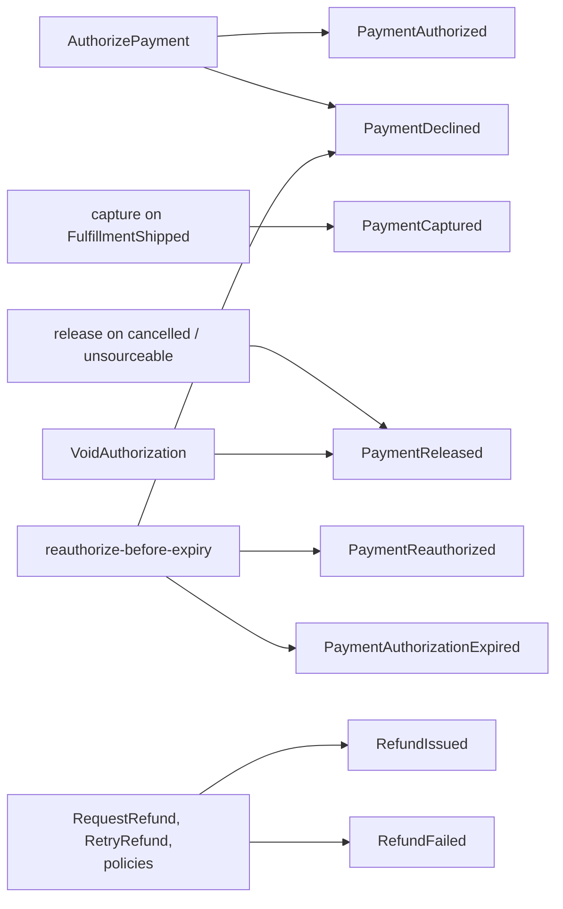

# Domain events

Customer Payments publishes eight events on `retailnetwork.customer-payments.events`
and consumes six from three topics. Field-by-field payloads, the CloudEvents
envelope and an example message are on [Events](/docs/api-reference/events); this page
shows how the events relate to the aggregates and flows.

## Published

| Event | Aggregate | Raised by | Reasons / variants |
| --- | --- | --- | --- |
| `PaymentAuthorized` | PaymentAuthorization | `AuthorizePayment` | none |
| `PaymentDeclined` | PaymentAuthorization | `AuthorizePayment`, `ReauthorizeBeforeExpiry` | provider code (`CARD_DECLINED` ...) or `REAUTH_DECLINED` |
| `PaymentCaptured` | PaymentAuthorization | capture of a shipped group | none |
| `PaymentReleased` | PaymentAuthorization | release of a group, or `VoidAuthorization` | `CANCELLED`, `UNSOURCEABLE`, `VOIDED`, `EXPIRED` |
| `PaymentAuthorizationExpired` | PaymentAuthorization | expiry (lapsed hold or declined re-authorization) | none |
| `PaymentReauthorized` | PaymentAuthorization | `ReauthorizeBeforeExpiry` | none |
| `RefundIssued` | Refund | `RequestRefund`, `RetryRefund`, `ProcessRequestedRefunds`, lost / returned policies | reasons `LOST`, `RETURNED_TO_SENDER`, `MANUAL` |
| `RefundFailed` | Refund | same | `final` true on the fifth failed attempt |

Subject and Kafka key: the `authorizationId` (payment events) or `refundId` (refund
events). Types: `com.retailnetwork.storefront.customer-payments.paymentauthorization.<Event>`
and `...refund.<Event>`. Source: `internal/domain/paymentauthorization/events.go`,
`internal/domain/refund/events.go`, `internal/adapters/outbound/kafka/payloads.go`.

Source: `internal/application/usecases/authorization.go`, `facts.go`, `policies.go`,
`refund.go`.

## Consumed

| Event | Topic | Effect |
| --- | --- | --- |
| `CheckoutCompleted` | `retailnetwork.checkout.events` | bind the order, replay parked facts |
| `FulfillmentShipped` | `retailnetwork.order-sourcing.events` | capture the group |
| `FulfillmentCancelled`, `FulfillmentUnsourceable` | `retailnetwork.order-sourcing.events` | release the group |
| `PackageLost`, `PackageReturned` | `retailnetwork.shipping-and-tracking.events` | refund the group by tracking number |

Source: `internal/adapters/inbound/kafka/handlers.go`.

## Guarantees

- **Publish:** transactional outbox, at-least-once; the CloudEvents `id` is fixed when
  the row is written, so redelivery repeats the same `id`. Consumers must dedupe on it.
- **Order:** per aggregate (key = subject, one partition); none across aggregates.
- **Consume:** the inbox claim and the effect commit together; the offset is committed
  after.
- **Evolution:** a breaking payload change is a new `.v2` type; the `dataschema` is
  `urn:retailnetwork:customer-payments:events:<EventName>:v1`.
