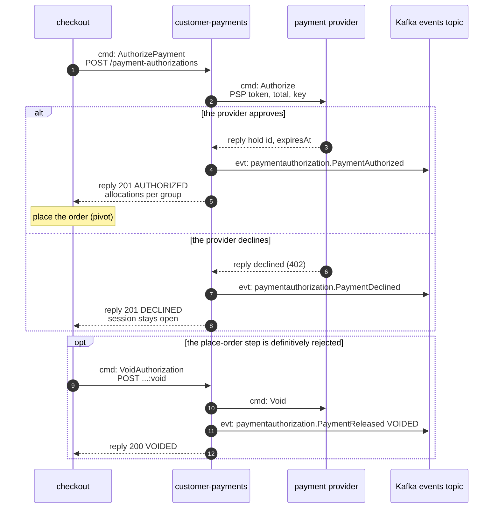
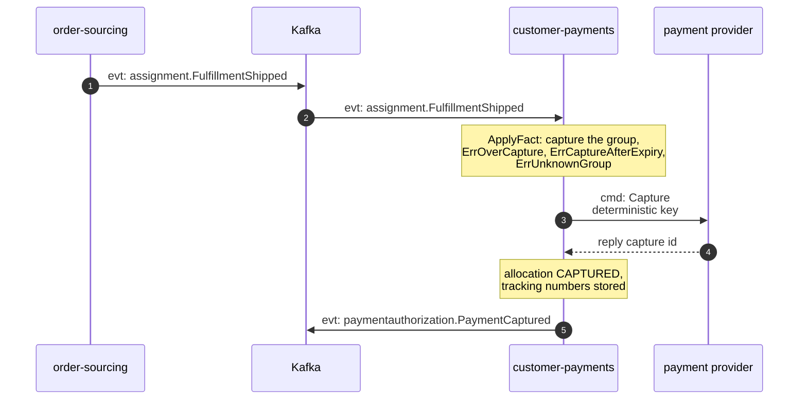
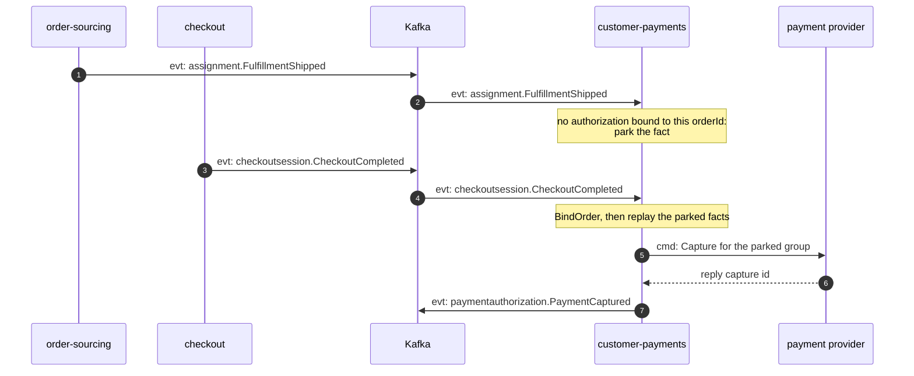
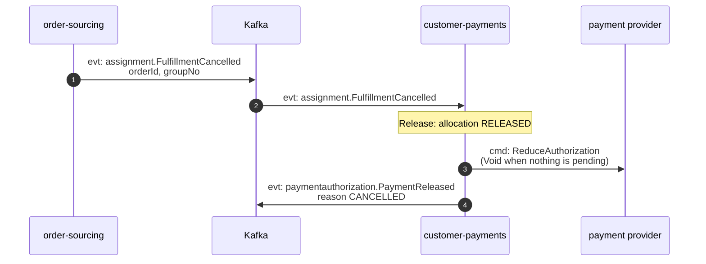
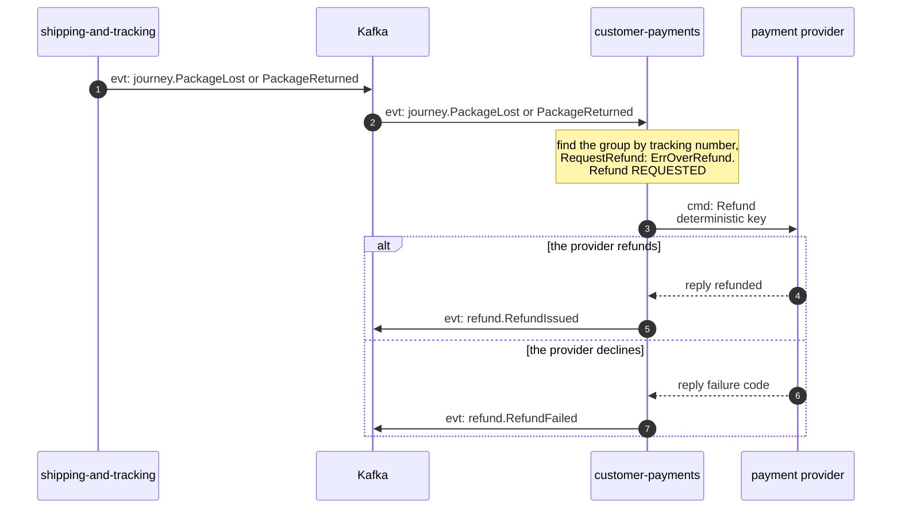
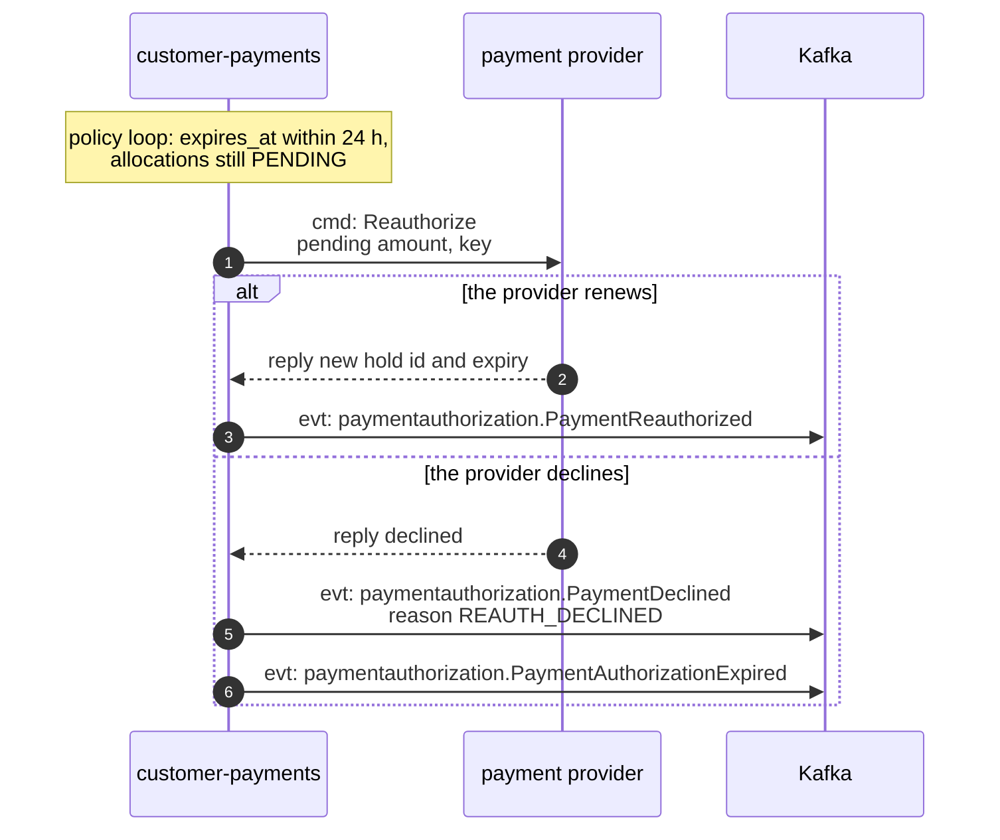

# Domain message flow

Following ddd-crew
[Domain Message Flow Modelling](https://github.com/ddd-crew/domain-message-flow-modelling).
Participants are contexts, actors and the provider; Kafka is one participant. Arrows are
prefixed `cmd:`, `qry:` or `evt:`. Event names are written `entity.EventName`; the full
type is `com.retailnetwork.storefront.customer-payments.<entity>.<EventName>`
([Events](/docs/api-reference/events)). Each diagram's `Source:` line names the code.

## 1. Checkout authorizes the payment, or voids it

Source: `internal/application/usecases/authorization.go` (`AuthorizePayment`,
`VoidAuthorization`), `internal/adapters/inbound/http/handlers.go`,
`internal/adapters/outbound/paymentprovider/client.go`. Omitted: the outbox write and
relay (see [Sequence diagrams](/docs/ddd/sequence-diagrams)); a provider outage is a 503
to retry under the same `Idempotency-Key`.

## 2. A shipped group is captured

Source: `internal/adapters/inbound/kafka/handlers.go` (`orderSourcingHandlers`),
`internal/application/usecases/consume.go` (`ApplyFact`), `facts.go` (`captureGroup`).

## 3. A fulfilment fact arrives before the order is bound

Source: `internal/application/usecases/consume.go` (`CheckoutCompleted`, `ApplyFact`),
`facts.go` (`replayParked`), `internal/application/parked`. The same parking applies to
cancelled, unsourceable, lost and returned facts. A fact that stays unbound for 24 h is
published to `retailnetwork.customer-payments.unbound-facts.dlq`.

## 4. A cancelled group is released

Source: `internal/application/usecases/facts.go` (`releaseGroup`, `shrinkHold`),
`internal/domain/paymentauthorization/commands.go` (`Release`). `FulfillmentUnsourceable`
runs the same flow with reason `UNSOURCEABLE`.

## 5. A lost or returned package is refunded

Source: `internal/application/usecases/facts.go` (`refundPackage`), `refund.go`
(`openRefund`, `settleRefund`), `internal/domain/refund`. A provider outage leaves the
refund `REQUESTED` and the `process-requested-refunds` policy retries it.

## 6. An authorization is re-authorized before it expires

Source: `internal/application/usecases/policies.go` (`ReauthorizeBeforeExpiry.renew`),
`cmd/api/policies.go`. Also on the loop: `void-unbound-authorizations` (no
`CheckoutCompleted` after 24 h: void).
