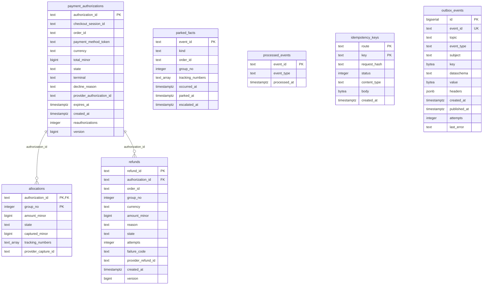

# Entity relationship

The schema as built: `internal/adapters/outbound/postgres/migrations/0001_customer_payments_schema.up.sql`,
applied at boot by golang-migrate (which adds its own `schema_migrations` table).
Customer Payments owns its database and shares no table with another context.
Seven tables. Key markers: PK primary key, FK foreign key, UK unique.

Source: `0001_customer_payments_schema.up.sql` (the same file builds the tables, checks
and indexes); the repositories in `internal/adapters/outbound/postgres/*.go`.

## Tables

| Table | Primary key | Role |
| --- | --- | --- |
| `payment_authorizations` | `authorization_id` | the `PaymentAuthorization` root. `CHECK` on `state` (7 values) and `terminal` (`VOIDED`, `EXPIRED`, `DECLINED`), currency pattern, non-negative total, `version >= 1`. |
| `allocations` | `(authorization_id, group_no)` | one row per shipment group; FK `ON DELETE CASCADE`; GIN index on `tracking_numbers` so a lost / returned tracking number finds its group. |
| `refunds` | `refund_id` | the `Refund` root; FK to the authorization; `CHECK` reason (`LOST`, `RETURNED_TO_SENDER`, `MANUAL`), state, `amount_minor >= 1`. |
| `parked_facts` | `event_id` | facts waiting for a bind (`kind` in `SHIPPED`, `CANCELLED`, `UNSOURCEABLE`, `LOST`, `RETURNED`); `escalated_at` marks the 24 h escalation. |
| `processed_events` | `event_id` | the inbox: one row per consumed CloudEvents id. |
| `idempotency_keys` | `(route, key)` | stored REST answers with a request hash; replayed with `Idempotent-Replayed: true`. |
| `outbox_events` | `id` | the transactional outbox the relay drains; `event_id` unique; `published_at IS NULL` is the work queue (partial index); `attempts` and `last_error` feed the attempt cap. |

## Constraints worth knowing

- `payment_authorizations_live_session_idx`: a unique index on `checkout_session_id`
  where `state <> 'DECLINED'`: one live authorization per checkout session. Declined
  attempts accumulate.
- `payment_authorizations_order_idx`: a unique index on `order_id` (when set and not
  declined): one authorization per order.
- Partial indexes serve the policies: `payment_authorizations_reauth_idx`
  (`expires_at` for live states), `payment_authorizations_unbound_idx` (`AUTHORIZED`
  with no order), `refunds_requested_idx` (`REQUESTED` refunds).
- The invariants themselves (over-capture, over-refund, allocation sum) are enforced by
  the aggregates in `internal/domain` before a row is written; the migration adds
  checks on scalar columns and the indexes above.
