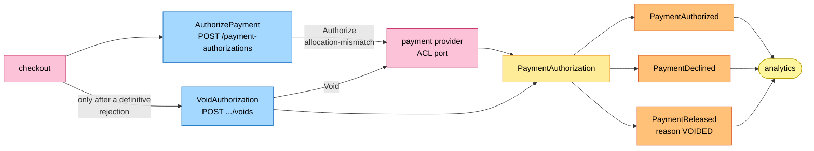
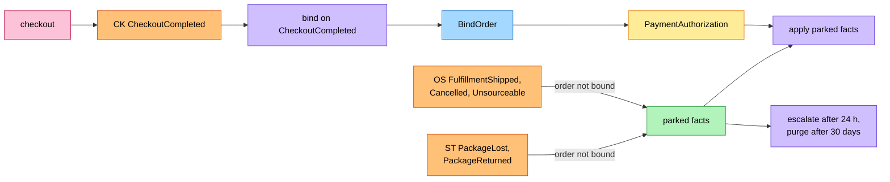
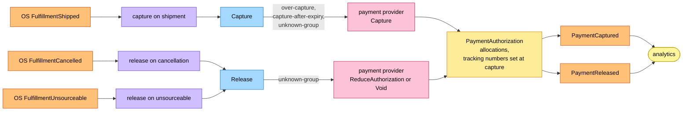
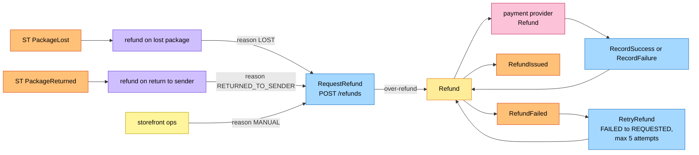
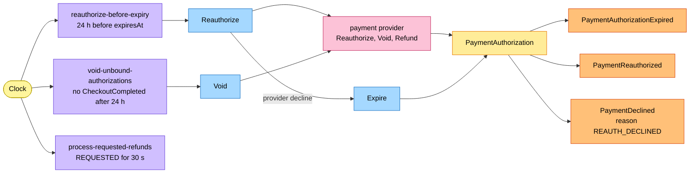

# EventStorming

Process-level boards in the ddd-crew
[EventStorming](https://github.com/ddd-crew/eventstorming-glossary-cheat-sheet)
notation. Every sticky comes from the code. Neighbour events are orange stickies
prefixed with the producer (`OS` order-sourcing, `ST` shipping-and-tracking, `CK`
checkout).

| Colour | Sticky |
| --- | --- |
| Pale yellow | Actor |
| Blue | Command |
| Yellow | Aggregate |
| Orange | Domain event |
| Lilac | Policy |
| Green | Read model |
| Pink | External system |

## 1. Authorize at checkout

Source: `internal/application/usecases/authorization.go`,
`internal/domain/paymentauthorization/events.go`.

## 2. Bind the order and apply parked facts

Source: `internal/application/usecases/consume.go`, `facts.go` (`replayParked`),
`policies.go` (`MaintainParkedFacts`), `internal/application/parked`.

## 3. Capture and release

Source: `internal/application/usecases/facts.go` (`captureGroup`, `releaseGroup`,
`shrinkHold`), `internal/domain/paymentauthorization/commands.go`.

## 4. Refunds

Source: `internal/application/usecases/refund.go`, `facts.go` (`refundPackage`),
`internal/domain/refund/refund.go`.

## 5. Clock policies

Source: `cmd/api/policies.go` (`policyRunners`),
`internal/application/usecases/policies.go`, `refund.go` (`ProcessRequestedRefunds`).

## Hotspots

The model's twelve hotspots (H1 to H12) are resolved in the code; what remains open:

| # | Hotspot | Evidence |
| --- | --- | --- |
| 1 | **No consumer of the eight events.** All are analytics-only by contract; nobody reacts. | `apis/asyncapi.yaml`; [Integration](/docs/ecosystem/integration) |
| 2 | **No alerting** on `payments.authorizations.decided`, parked facts, unpublished outbox rows or a failed refund; only ERROR log lines (`ALERT refund failed for good`, `ALERT fact for an unbound order dead-lettered`). | [Observability](/docs/operations/observability#dashboards-and-alerts) |
| 3 | **A fact for a tracking number no capture carries** is parked until 24 h, then escalated; a lost package whose shipment fact never arrived is never refunded automatically. | `facts.go` (`refundPackage`), `policies.go` |
| 4 | **OpenAPI drift**: `RELEASED`, `GET /refunds/{refundId}` and `POST /refunds/{refundId}:retry` are not in `apis/openapi.yaml` (the `200` replay is). | [API overview](/docs/api-reference#spec-versus-code) |
| 5 | **Expiry without re-authorization**: a provider outage longer than the 24 h lead lets a hold lapse; the next pass expires the authorization without asking the provider. | `policies.go` (`renew`) |
