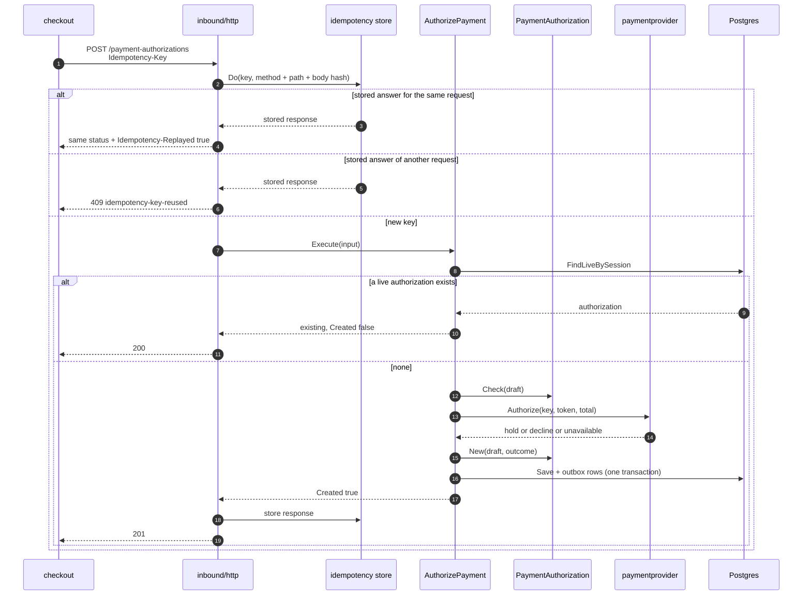
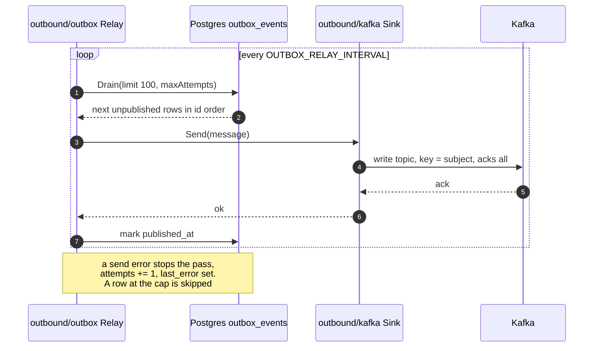
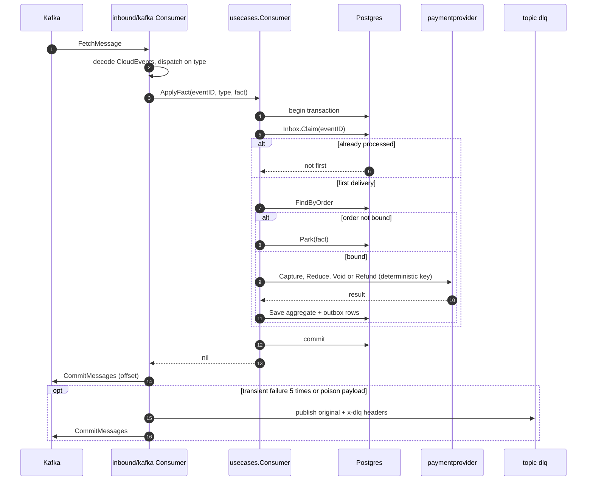
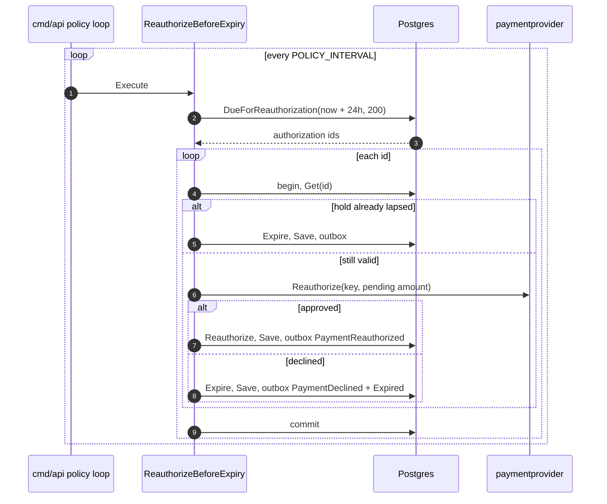
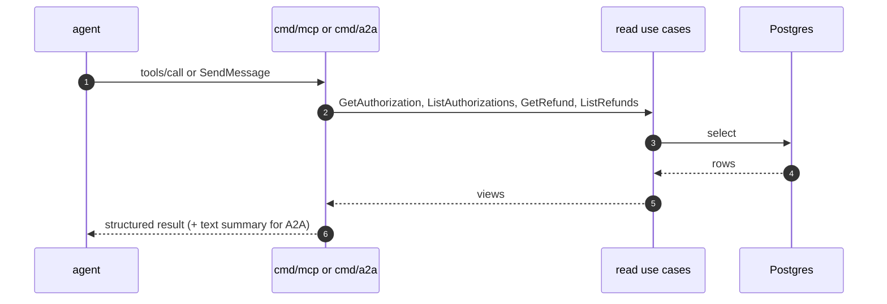

# Sequence diagrams

Participant names are code packages. Every flow that changes state shares the
transaction pattern of [Architecture](/docs/overview/architecture): the aggregate, the
inbox claim (for consumed events) and the outbox rows are written in one transaction;
the relay publishes after the commit. A `;` never appears inside a message so the
diagrams stay valid Mermaid.

## 1. POST /payment-authorizations

Source: `internal/adapters/inbound/http/idempotency.go` (`RequireIdempotencyKey`),
`handlers.go` (`handleAuthorize`), `internal/application/usecases/authorization.go`,
`internal/adapters/outbound/paymentprovider/client.go`. On `unavailable` the use case
returns the error and nothing is stored (503).

## 2. Outbox relay to Kafka

Source: `internal/adapters/outbound/outbox/relay.go`,
`internal/adapters/outbound/postgres/outbox.go`,
`internal/adapters/outbound/kafka/sink.go`, `writer.go`. A full batch is followed
immediately by another pass.

## 3. Consuming a fulfilment fact

Source: `internal/adapters/inbound/kafka/kafka.go` (`consumeLoop.run`,
`handleWithDeadLetter`), `deadletter.go`, `internal/application/usecases/consume.go`
(`once`), `facts.go`. The provider call is repeated with the same key if the
transaction is retried.

## 4. Policy pass: re-authorization

Source: `cmd/api/policies.go` (`startPolicies`, `runPolicies`),
`internal/application/usecases/policies.go` (`ReauthorizeBeforeExpiry`). A provider
outage, a concurrent update or an illegal transition skips that authorization with a
WARN and retries at the next tick.

## 5. Read path: MCP tool and A2A skill

Source: `internal/adapters/inbound/mcp/tools.go`, `internal/adapters/inbound/a2a/skills.go`,
`cmd/mcp/main.go`, `cmd/a2a/main.go`. These binaries wire no write use case, no outbox
and no provider.
