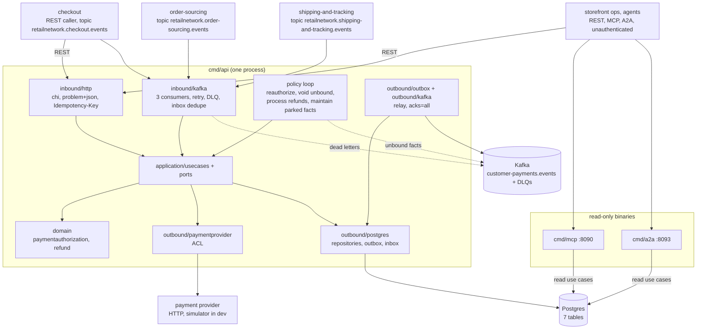

# Architecture

`customer-payments` follows the fleet's hexagonal (ports and adapters) layout:
dependencies point inward, the domain imports nothing from the rest of the
module, and only `cmd/` wires the layers together. Everything on this page is
on `develop`.

## Layout

| Layer | Path | Role |
| --- | --- | --- |
| Domain | `internal/domain/paymentauthorization` | `PaymentAuthorization` aggregate: states `AUTHORIZED`, `PARTIALLY_CAPTURED`, `CAPTURED`, `RELEASED`, `VOIDED`, `EXPIRED`, `DECLINED`; allocations per shipment group (`PENDING`, `CAPTURED`, `RELEASED`); commands (`create.go`, `commands.go`), events (`events.go`), `Restore`. |
| Domain | `internal/domain/refund` | `Refund` aggregate: `REQUESTED`, then `SUCCEEDED` or `FAILED`; `MaxAttempts = 5`; the over-refund invariant via `Limits`. |
| Domain | `internal/domain/shared` | `Money` helpers, id and currency validation, `Event` interface, `ErrValidation`, `ErrIllegalTransition`. |
| Application | `internal/application/usecases` | One struct per use case (see [Use cases](/docs/ddd/use-cases)): `AuthorizePayment`, `VoidAuthorization`, `GetAuthorization`, `ListAuthorizations`, `RequestRefund`, `RetryRefund`, `GetRefund`, `ListRefunds`, the `Consumer` (`CheckoutCompleted`, `ApplyFact`) and the four policies. `Deps` bundles the ports. |
| Application | `internal/application/ports` | OUT interfaces only: repositories, `UnitOfWork`, `EventOutbox`, `Inbox`, `ParkedFacts`, `Clock`, `IDGenerator`, `PaymentProvider`, `Escalator`, `PaymentMetrics`, `IdempotencyStore`. |
| Application | `internal/application/{idempotency,outbox,parked,provider,views}` | The `Idempotency-Key` record, the already-encoded outbox `Message`, the parked-fact type and its kinds, the provider's request / hold / decline types, and the read models returned to adapters. |
| Inbound adapter | `internal/adapters/inbound/http` | chi router for `apis/openapi.yaml`: handlers, RFC 9457 problem mapping (`errors.go`), the `Idempotency-Key` middleware, `/healthz`, `/readyz`, `/metrics`. No auth middleware. |
| Inbound adapter | `internal/adapters/inbound/kafka` | The checkout, order-sourcing and shipping-and-tracking consumers: CloudEvents decode, dispatch on the full `type`, retry with backoff, dead-letter topic, consumer spans. Decode only; every effect is a use case. |
| Inbound adapter | `internal/adapters/inbound/mcp` | The four read-only MCP tools over the read use cases (`cmd/mcp`). |
| Inbound adapter | `internal/adapters/inbound/a2a` | The two read-only A2A skills and the Agent Card (`cmd/a2a`, [ADR 0005](/docs/adr/0005-a2a-inbound-adapter)). |
| Inbound adapter | `internal/adapters/inbound/requestlog` | The access-log middleware shared by the three routers. |
| Outbound adapter | `internal/adapters/outbound/postgres` | pgxpool repositories, `UnitOfWork` (`pgtx`), outbox repository, inbox, parked facts, idempotency store, embedded migrations. |
| Outbound adapter | `internal/adapters/outbound/paymentprovider` | The Anti-Corruption Layer: HTTP client for `PAYMENT_PROVIDER_URL` (10 s timeout; 402 = decline, 429 and 5xx = unavailable). |
| Outbound adapter | `internal/adapters/outbound/outbox` | The relay loop that drains `outbox_events` to a sink. |
| Outbound adapter | `internal/adapters/outbound/kafka` | `NewWriter` (acks=all, hash balancer, no fixed topic, `AllowAutoTopicCreation`), the event `Encoder`, the relay `Sink`, the `Escalator` for unbound facts and `BrokerCheck` (the Kafka half of `/readyz`). |
| Outbound adapter | `internal/adapters/outbound/telemetry` | OTel setup, the `slog` trace handler, the `payments.authorizations.decided` counter. |
| Outbound adapter | `internal/adapters/outbound/{clock,ids}` | Wall clock and id source. |
| Outbound adapter | `internal/adapters/outbound/memory` | In-memory implementation of every port: a **test double** for the unit and godog suites. No `cmd/**` imports it (`TestRuntimeBinaryHasNoInMemoryAdapters`). |
| Kafka envelope | `internal/adapters/kafka/cloudevents` | The only place a CloudEvents 1.0 envelope is built or decoded: `New(Spec)`, `Decode`, `ContentTypeHeader`, `Type`, `DataSchema`. Constants `Tier = "storefront"`, `Context = "customer-payments"`, `Source = "/retailnetwork/customer-payments"`. |
| Support | `internal/bootretry` | Exponential-backoff retry for the first outbound dials at boot. |
| Test support | `internal/testing/{kafkatest,pgtest,providerfake}`, `internal/adapters/outbound/repocontract` | testcontainers helpers, an HTTP fake of the provider, and the repository contract suite run against both memory and Postgres. |
| Fitness tests | `internal/architecture` | Source-scanning and dependency tests; see [Testing](/docs/development/testing). |

## Binaries and ports

| Binary | Role | Port | Probes |
| --- | --- | --- | --- |
| `cmd/api` | REST API, the three Kafka consumers, the outbox relay and the policy loop in one process, all always on, on real Postgres and Kafka. A worker that returns on its own exits the process. | `HTTP_ADDR`, default `:8080` | `GET /healthz` (liveness), `GET /readyz` (drain gate, Postgres ping, a Kafka broker answers a metadata request; never topics) |
| `cmd/mcp` | Read-only MCP server (Streamable HTTP, `/mcp`) over the read use cases; runs the migrations, but no relay, consumer or policy; never dials Kafka or the provider. | `MCP_ADDR`, default `:8090` | `GET /healthz` |
| `cmd/a2a` | Read-only A2A server: JSON-RPC 2.0 at `/` and `/a2a`, Agent Card at `/.well-known/agent-card.json`; same read use cases; no Kafka, no provider. | `A2A_ADDR`, default `:8093` | `GET /healthz` |

There is no `web/` and no analytics projector in this repository. How `cmd/api`
boots and in which order it stops is in the [Runbook](/docs/operations/runbook);
every variable is in [Configuration](/docs/operations/configuration).

## Container diagram

Source: `cmd/api/main.go` (wiring, `consumerSpecs`, `startOutboxRelay`),
`cmd/api/policies.go`, `cmd/mcp/main.go`, `cmd/a2a/main.go`,
`internal/application/usecases/deps.go` and the import lists of
`internal/adapters/**`. The in-memory adapters are not in the diagram because no
binary wires them.

## Data stores

One Postgres database, created by the single embedded migration
(`internal/adapters/outbound/postgres/migrations/0001_customer_payments_schema.up.sql`),
shared by the three binaries (`cmd/api` is the only writer):

| Table | Holds |
| --- | --- |
| `payment_authorizations` | The aggregate root: state, `checkout_session_id`, `order_id` (bound later), PSP token, `provider_authorization_id`, `expires_at`, `reauthorizations`, optimistic `version`. A unique partial index allows one non-`DECLINED` authorization per checkout session and per order. |
| `allocations` | One row per shipment group: `amount_minor`, `state`, `captured_minor`, `tracking_numbers`, `provider_capture_id`. |
| `refunds` | The `Refund` aggregate: `state`, `attempts`, `failure_code`, `provider_refund_id`, `version`. |
| `parked_facts` | Fulfilment and tracking facts whose order is not bound yet (or whose tracking number no capture carries yet), with `parked_at` and `escalated_at`. |
| `processed_events` | The inbox: one row per consumed CloudEvents `id`. |
| `idempotency_keys` | Stored answers of the `POST` routes, keyed by `(route, key)` with a request hash. |
| `outbox_events` | The transactional outbox: encoded CloudEvents, topic, key, headers (including `traceparent`), `published_at`, `attempts`, `last_error`. |

Postgres is the only store; the service refuses to boot without `DATABASE_URL`.
Kafka is the fleet's single broker: this service produces to
`retailnetwork.customer-payments.events` (and, for stale facts, to
`retailnetwork.customer-payments.unbound-facts.dlq`) and consumes
`retailnetwork.checkout.events`, `retailnetwork.order-sourcing.events` and
`retailnetwork.shipping-and-tracking.events`. It never creates a topic through
an admin API: the broker auto-creates each on first write, and `/readyz` waits
for no topic.

## How a command is processed

Every command runs inside one `UnitOfWork`: load the aggregate with its
`version`, let the domain decide, call the payment provider with a deterministic
key (`Key(operation, authorizationId, groupNo, qualifier)`), save the aggregate
conditionally on the version, append the raised events to the outbox, and answer.
A version conflict reruns the whole attempt (twice for commands, five times for
consumers) before surfacing as `409 concurrent-update`. The relay publishes the
outbox rows after the commit, so an event is never published for a rolled-back
change and never lost for a committed one. The provider call sits inside the
transaction callback but its key is deterministic, so a retried attempt cannot
move money twice. See [Sequence diagrams](/docs/ddd/sequence-diagrams).
